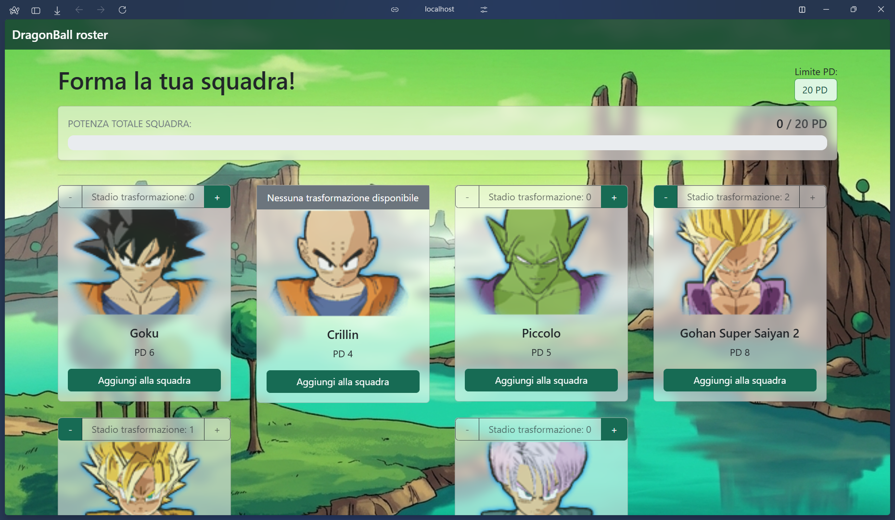
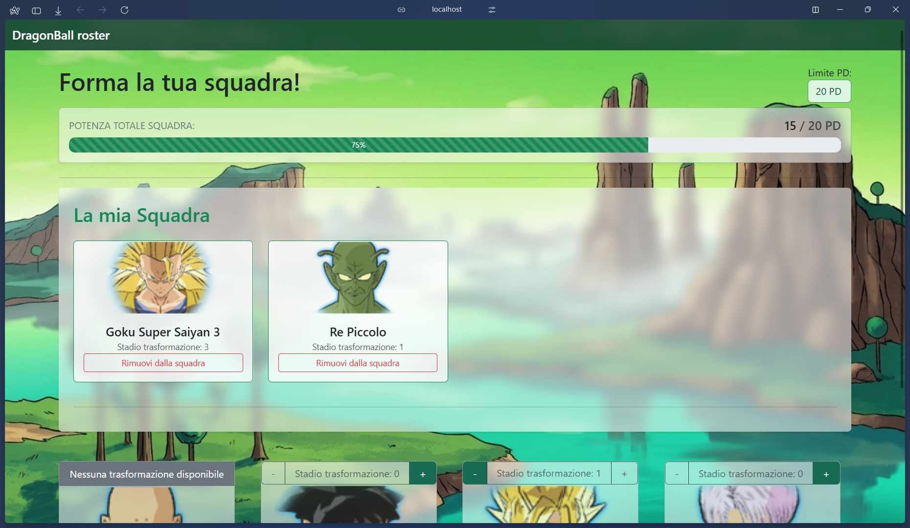
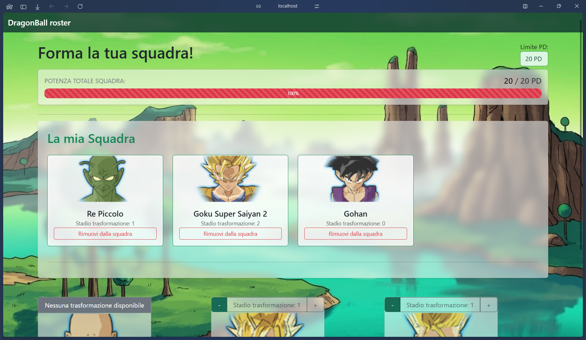
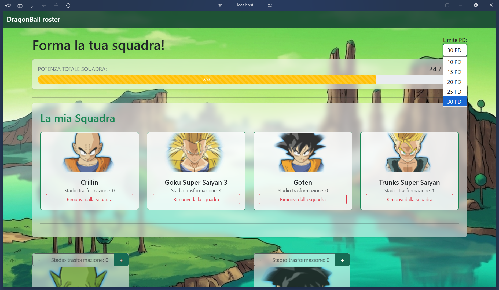

# db_roster

Per la versione in inglese del README, clicca qui: [README in English](./README.md).

db_roster è una piccola applicazione web interattiva per creare una squadra di personaggi di Dragon Ball, realizzata come esercitazione pratica per lo studio di React.
Puoi consultare il roster, trasformare i personaggi disponibili per aumentarne i punti danno (PD), reclutarli o rimuoverli dalla squadra e scegliere il quantitativo di PD massimo desiderato. Un indicatore mostra i PD totali e l'app impedisce le operazioni che supererebbero il limite impostato. L'interfaccia include uno sfondo a tema e schede dedicate ai personaggi.

## Anteprime

<table>
  <tr>
    <td></td>
    <td></td>
    <td></td>
    <td></td>
  </tr>
</table>

## Tecnologie utilizzate

- **React** per componenti e gestione dello stato dell'interfaccia.
- **JavaScript (ES6+)** per la logica dell'applicazione.
- **HTML5 e CSS3** per struttura e stili personalizzati.
- **Bootstrap 5** per layout, componenti e utility responsive.

## Struttura del progetto

```text
.
├── public/
│   ├── goku.png
│   ├── index.html
├── src/
│   ├── components/
│   │   ├── card.js
│   │   └── navbar.js
│   ├── images/          sprite dei personaggi e sfondo
│   ├── App.js
│   ├── index.css
│   └── index.js
├── .gitignore
├── package.json
├── README.md
└── README.it.md
```

Le cartelle generate come `node_modules/` e `build/` sono omesse.

## Avvio

```sh
npm install
npm start
```


## Build

```sh
npm run build
```


## Crediti e Risorse Grafiche

* **Sprite dei Personaggi:** Ritratti estratti dal videogioco *Dragon Ball Z: Budokai 3* (PlayStation 2). Estratti (*ripped*) da **G.o.D.** e reperiti tramite [The Sprite Database](http://spritedatabase.net/).
* **Immagine di Sfondo:** Illustrazione originale generata tramite Intelligenza Artificiale, ispirata ai paesaggi iconici dell'universo di *Dragon Ball Z*.


## Licenza, Disclaimer e Copyright

Questo è un progetto amatoriale senza scopo di lucro, realizzato esclusivamente a fini didattici e di portfolio per approfondire lo sviluppo front-end con React.

* **Codice Sorgente:** Copyright © 2026 [Valerio Galfano]. **Tutti i diritti riservati.** Il codice di questo progetto è pubblicato esclusivamente per fini di consultazione e valutazione portfolio; ne sono vietati la copia, la modifica, la distribuzione o qualsiasi altro utilizzo senza l'esplicita autorizzazione scritta dell'autore.
* *Dragon Ball*, *Dragon Ball Z* e tutti i relativi personaggi, nomi e sprite originali del videogioco sono marchi registrati e di proprietà di **Akira Toriyama**, **Bird Studio / Shueisha**, **Toei Animation** e **Bandai Namco Entertainment**.
* Non si intende violare alcun diritto d'autore. Tutti i diritti appartengono ai rispettivi proprietari.