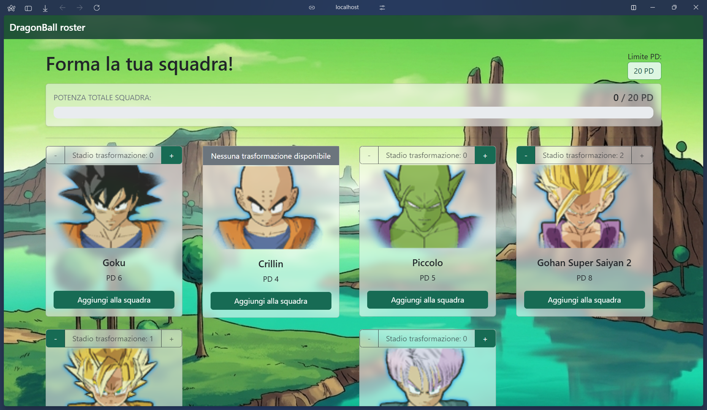
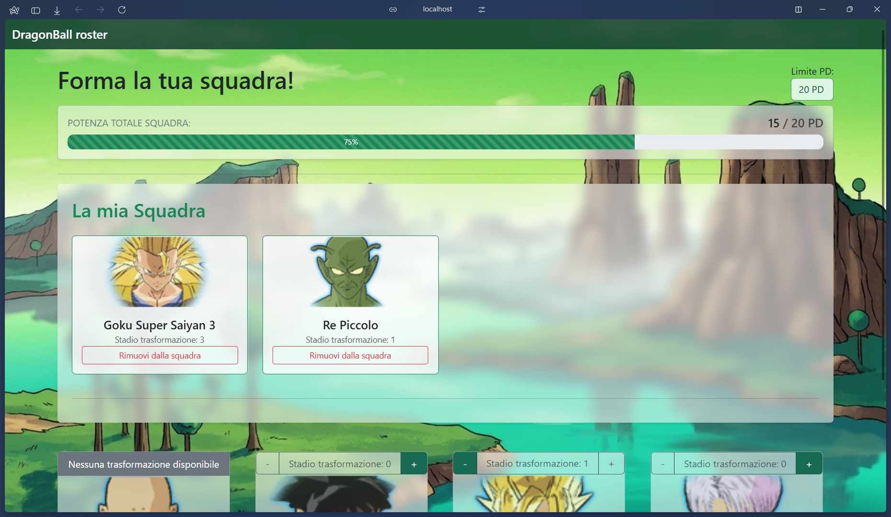
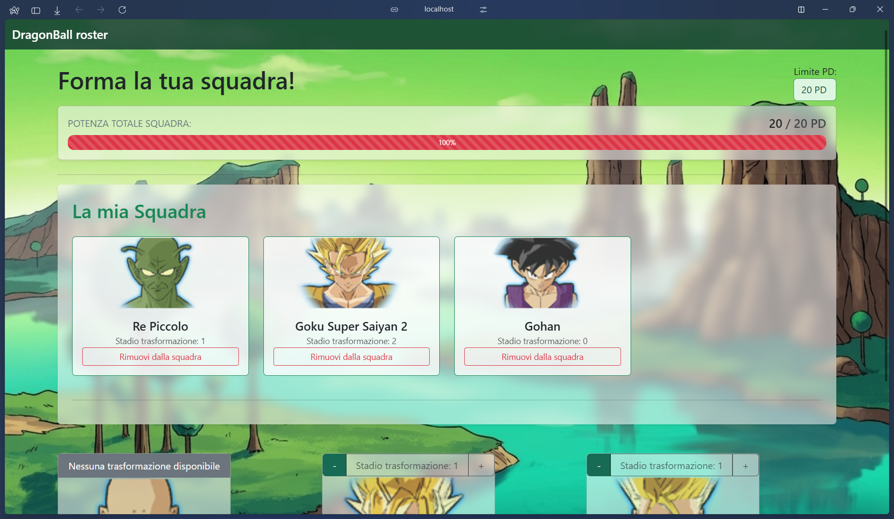
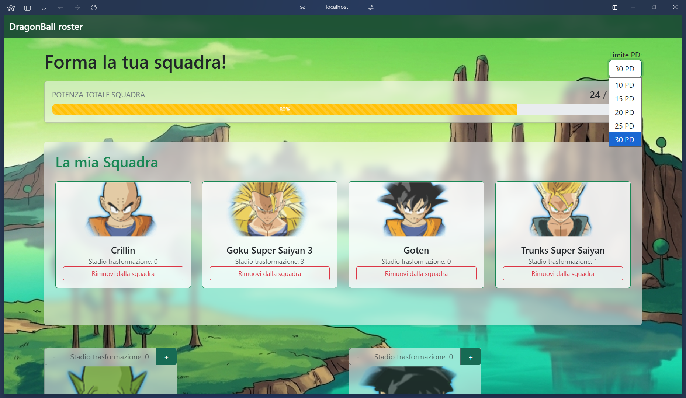

# db_roster

For the Italian version of this README, click here: [README in italiano](./README.it.md).

db_roster is a small interactive web application for building a team of Dragon Ball characters, created as a hands-on exercise in learning React.
You can browse the roster, transform available characters to increase their damage points (DP), recruit them to or remove them from your team, and choose a maximum DP budget. An indicator displays the team's total DP, and the app prevents actions that would exceed the selected limit. The interface features a themed background and character cards.

## Previews

<table>
  <tr>
    <td></td>
    <td></td>
    <td></td>
    <td></td>
  </tr>
</table>

## Technologies

- **React** for components and interface state management.
- **JavaScript (ES6+)** for application logic.
- **HTML5 and CSS3** for structure and custom styles.
- **Bootstrap 5** for layout, components, and responsive utilities.

## Project structure

```text
.
├── public/
│   ├── goku.png
│   ├── index.html
├── src/
│   ├── components/
│   │   ├── card.js
│   │   └── navbar.js
│   ├── images/          character sprites and wallpaper
│   ├── App.js
│   ├── index.css
│   └── index.js
├── .gitignore
├── package.json
├── README.md
└── README.it.md
```

Generated folders such as `node_modules/` and `build/` are omitted.

## Getting started

```sh
npm install
npm start
```

## Build

```sh
npm run build
```


## Credits & Assets

* **Character Sprites:** Small portraits extracted from *Dragon Ball Z: Budokai 3* (PlayStation 2). Ripped by **G.o.D.** and sourced via [The Sprite Database](http://spritedatabase.net/).
* **Background Image:** Custom AI-generated artwork inspired by the iconic landscapes of the *Dragon Ball Z* universe.


## License, Disclaimer & Copyright

This is a non-commercial project created strictly for educational and portfolio purposes to practice front-end development with React.

* **Source Code:** Copyright © 2026 [Valerio Galfano]. **All rights reserved.** The source code of this project is shared publicly solely for viewing and portfolio evaluation; any unauthorized copying, modification, distribution, or use is strictly prohibited without prior written permission from the author.
* *Dragon Ball*, *Dragon Ball Z*, and all related characters, names, and original game sprites are trademarks and copyrights of **Akira Toriyama**, **Bird Studio / Shueisha**, **Toei Animation**, and **Bandai Namco Entertainment**.
* No copyright infringement is intended. All rights belong to their respective owners.